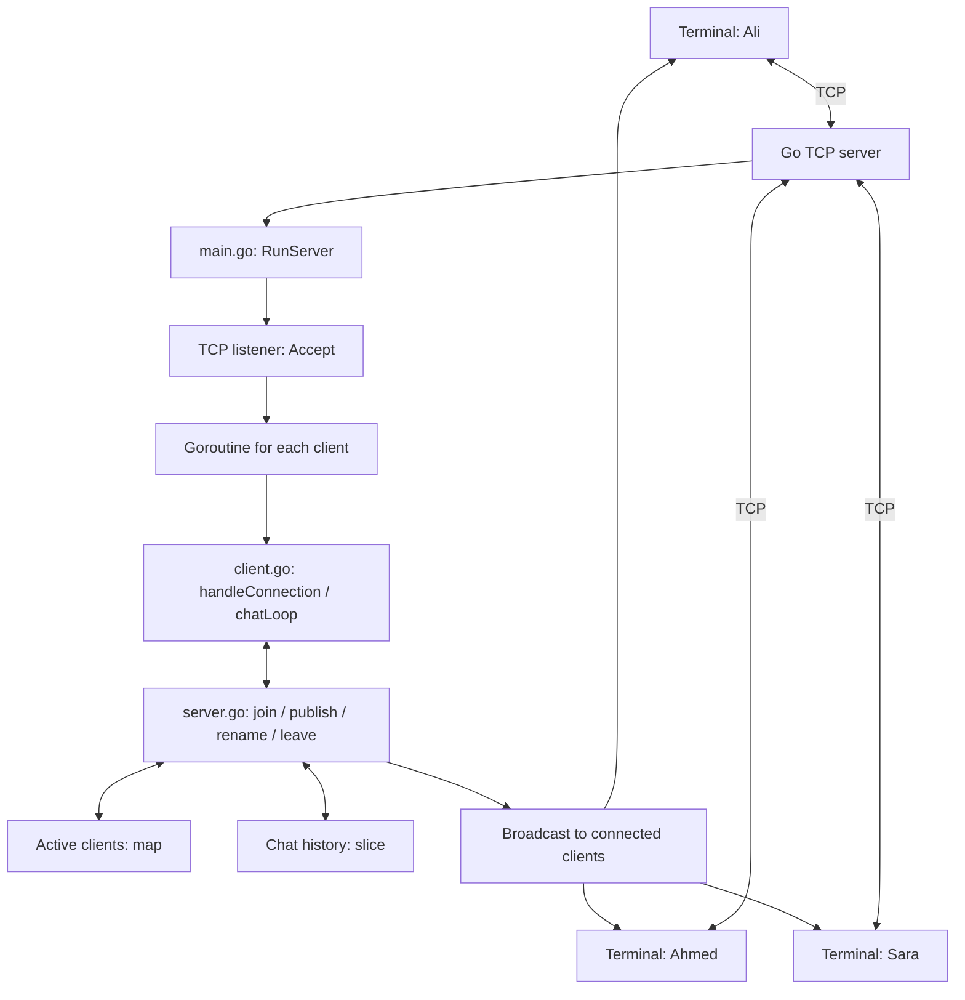
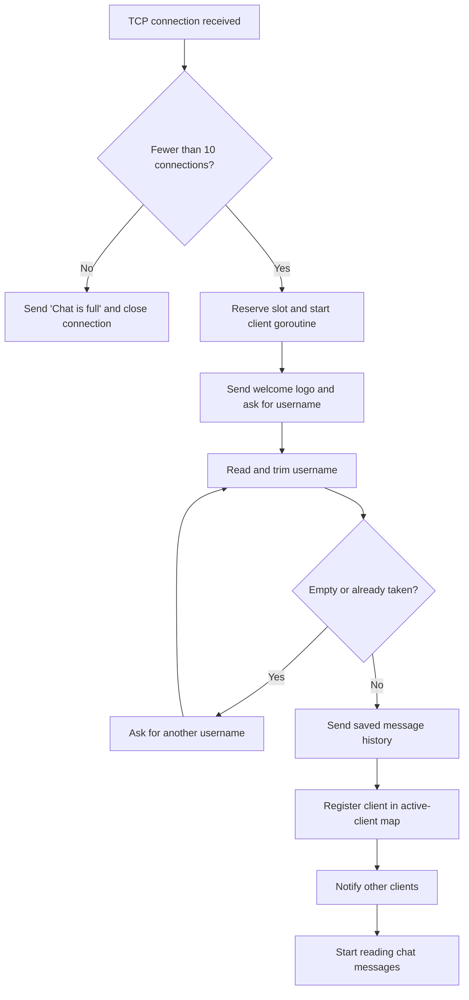
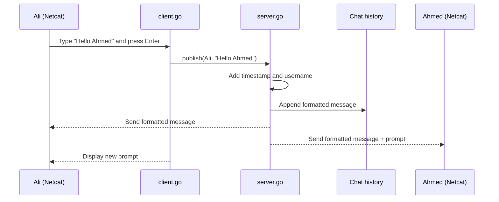
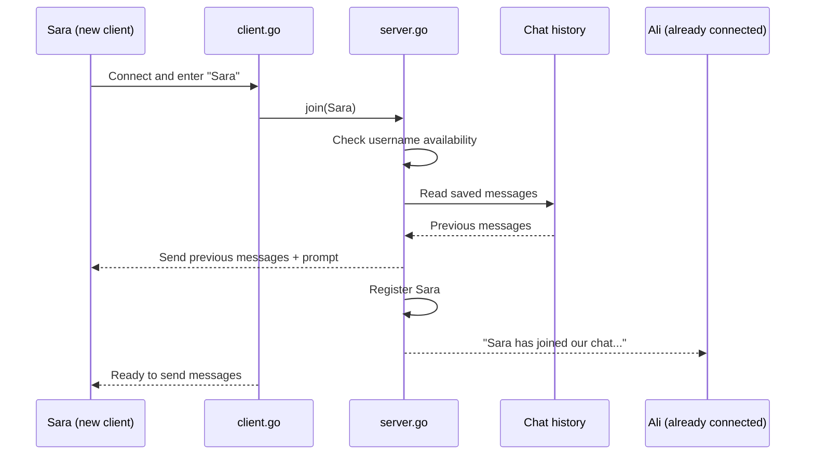
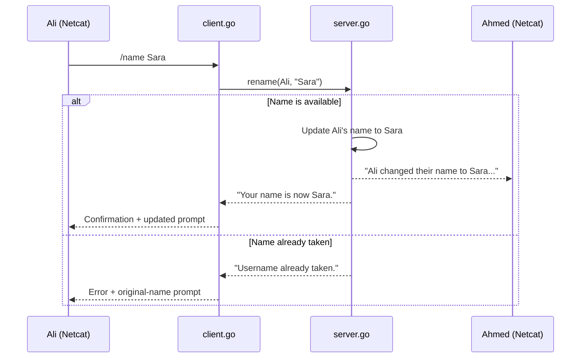

Net-Cat
A terminal-based group chat application written in Go. Net-Cat uses TCP connections to let multiple clients exchange messages through one server in real time.

The server welcomes each client with an ASCII Linux logo, asks for a username, keeps message history, and notifies connected clients when someone joins, leaves, or changes their name.
Features
- Start the TCP server on the default port 8989 or choose a custom port.
- Support up to 10 simultaneous connections.
- Display an ASCII Linux logo and ask every new client to enter a username.
- Reject empty or duplicate usernames without disconnecting the client.
- Compare usernames without case sensitivity (Ali and ali are considered the same name).
- Allow connected clients to change their name using /name NewName.
- Notify other clients when someone joins, leaves, or changes their name.
- Exchange messages between all connected clients, including the sender.
- Attach the sender's name and the server's timestamp to every chat message.
- Save previous messages in memory and show them to new clients when they join.
- Ignore messages containing only spaces or an empty line.
- Handle multiple connections using goroutines and protect shared data using mutexes.
- Include automated tests for connection limits, usernames, and basic server behavior.
Technology Stack
Technology	Purpose
Go	TCP server, client handling, chat logic, and concurrency
Go standard library	Networking, input processing, synchronization, and timestamps
TCP	Reliable, connection-oriented communication between server and clients
Netcat (nc)	Terminal client used to join and test the chat
Goroutines	Handle multiple connected clients concurrently
Mutexes (sync.Mutex)	Coordinate access to shared server data and client writes
In-memory slice and map	Store chat history and track active clients

No external Go packages, database, frontend, or web browser are required.
Project Structure
net-cat/
├── go.mod
├── main.go
├── README.md
├── .gitignore
└── tcpchat/
    ├── server.go
    ├── client.go
    ├── logo.go
    └── server_test.go
File	Responsibility
main.go	Reads command-line arguments and starts the server
tcpchat/server.go	Accepts connections, enforces connection limits, tracks clients, saves history, broadcasts messages, and changes usernames
tcpchat/client.go	Welcomes clients, validates usernames, reads messages, processes /name, and handles disconnections
tcpchat/logo.go	Stores the welcome banner and username prompt
tcpchat/server_test.go	Tests connection limits, basic server state, and username behavior
go.mod	Defines the project module and Go version
.gitignore	Excludes generated executables and other local files from version control

Requirements
- Go compatible with the version declared in go.mod (Go 1.25.6).
- Ubuntu/Linux, Windows, or another system that can run Go.
- A terminal with Netcat (nc) or Ncat for connecting as a chat client.
- An available TCP port (8989 by default).
For Ubuntu, install Netcat if necessary:
sudo apt update
sudo apt install -y netcat-openbsd
Build and Run
Run the commands from the project root directory.

Build the Linux executable:
cd net-cat
go build -o TCPChat .
Start on the default port:
./TCPChat
Expected output:
Listening on the port :8989
Start on a custom port:
./TCPChat 2525
Expected output:
Listening on the port :2525
Run without building an executable first:
go run .
Invalid command-line arguments:
./TCPChat 2525 localhost
Output:
[USAGE]: ./TCPChat $port
The server continues running while waiting for clients. Press Ctrl+C in the server terminal to stop it.

Windows: Build with go build -o TCPChat.exe . and launch ./TCPChat.exe from Git Bash or PowerShell. Linux executables and Windows executables are different, so build for the operating system where the server will run.
Connecting Clients
Keep the server running in the first terminal. Open a second terminal and connect using Netcat:
nc 127.0.0.1 8989
Open a third terminal and repeat the same command to connect another client.

If the server is running on port 2525, connect using:
nc 127.0.0.1 2525
The client first sees the welcome banner:
Welcome to TCP-Chat!
         _nnnn_
        dGGGGMMb
       @p~qp~~qMb
       ...
[ENTER YOUR NAME]:
Enter a name and press Enter to join the chat.
Example Conversation
Client 1 joins as Ali. Client 2 joins as Ahmed.

Ali's terminal:
[ENTER YOUR NAME]: Ali
[2026-10-21 20:10:00][Ali]:
Ahmed has joined our chat...
[2026-10-21 20:10:05][Ali]:Hello Ahmed

[2026-10-21 20:10:08][Ali]:Hello Ahmed
[2026-10-21 20:10:08][Ali]:
Ahmed's terminal receives:
[2026-10-21 20:10:08][Ali]:Hello Ahmed
[2026-10-21 20:10:08][Ahmed]:
Timestamps are examples. The server uses the time when each message is processed. Because Netcat can display locally typed input, the sender may also see an additional server-formatted copy of their message.
Application Architecture
Net-Cat follows a client-server architecture. Every client communicates with the Go server through an individual TCP connection; clients do not send messages directly to one another.

Architecture Components
Component	Responsibility
Terminal clients	Send usernames, commands, and chat messages using Netcat (nc)
TCP listener	Listens on port 8989 (or the selected port) and accepts connections
Client goroutine	Manages one connection independently using handleConnection()
Client handler	Reads input, validates names, and sends text to the appropriate server function
Server manager	Registers clients, formats and distributes messages, and processes name changes
Client map	Tracks clients who successfully joined the chat
History slice	Keeps chat messages in memory so later clients can read them

The flowchart shows the main responsibilities, rather than separate network services: these Go functions run inside one server process.
Main Go Functions
These functions play the same explanatory role that an endpoints table plays in a web application's README, but they are internal Go functions, not HTTP endpoints.
File	Function	Purpose
main.go	main()	Selects the server port and starts the application
server.go	RunServer()	Listens for connections and starts client goroutines
server.go	reserveConnection() / releaseConnection()	Enforces the 10-connection limit
server.go	join() / leave()	Adds or removes members and notifies the chat
server.go	publish()	Formats, stores, and broadcasts messages
server.go	nameTaken() / rename()	Prevents duplicate usernames and handles name changes
client.go	handleConnection()	Welcomes a client and validates the chosen username
client.go	chatLoop()	Reads messages and checks for /name commands
client.go	send() / sendWithPrompt()	Writes text to a client's terminal safely
client.go	prompt()	Generates a timestamped username prompt

How the Chat Works
Server Startup
1. main.go selects port 8989 unless a custom port is provided.
2. RunServer() starts a TCP listener on that port.
3. The server waits for new connections using Accept().
4. A connection slot is reserved if fewer than 10 connections are active.
5. A separate goroutine begins handling each accepted client.
Client Connection and Username
The following diagram shows what happens after a client connects. The connection limit is checked before the welcome message and username selection.

The server checks duplicate usernames case-insensitively, so Ali and ali cannot be used by two active members. A client with a rejected username remains connected and may try again. The server frees the reserved connection slot when the client disconnects.
Sending Messages
Messages pass through the server, which adds the timestamp, saves the result, and distributes it. This is a sequence diagram, so read the arrows from top to bottom.

Message format:
[YYYY-MM-DD HH:MM:SS][Username]:Message
For example:
[2026-10-21 20:35:10][Ali]:Hello Ahmed
Blank or whitespace-only lines are ignored. A new client joining later receives the saved history in order, before being registered for live messages.
New Client Receives History

Disconnecting
When a client closes Netcat (for example, using Ctrl+C), the server removes that client, informs the remaining members, and makes the connection slot and username available again.
Commands and Username Rules
Net-Cat is a TCP terminal application, not a website. It does not have HTTP routes or API endpoints. Instead, users type commands or messages into their Netcat connection.
Supported Client Inputs
Input	Result
Ali at the name prompt	Joins the chat if the name is available
ali when Ali is connected	Rejected as a duplicate name
Empty name	Asked to enter a name again
Hello everyone	Sends a timestamped chat message
Empty chat message	Ignored
/name Ahmed	Changes the current username if Ahmed is available
/name	Shows command usage

Change-name example:

Ali types:
/name Ahmed
Ali sees:
Your name is now Ahmed.
Other clients see:
Ali changed their name to Ahmed...
A duplicate new name is rejected and the client's existing name is preserved. Commands such as /name are not saved as ordinary chat messages.
Rename Request Flow

Connection Limit
The server allows up to 10 simultaneous TCP connections, including connections where a user has not entered a name yet.

If an 11th client tries to connect, the server sends:
Chat is full. Maximum 10 connections allowed.
The extra connection is then closed; existing clients remain connected. When someone leaves, another client can use the available slot.
Concurrency and Synchronization
The server uses goroutines so one client's activity does not prevent the program from accepting other connections.

Two mutexes coordinate concurrent operations:
Mutex	Responsibility
Server.mu	Protects the connection count, active-client list, usernames, and shared message history
Client.writeMu	Prevents simultaneous writes to the same client's TCP connection

Network writes use a timeout to limit how long an unresponsive connection can delay a send. Messages and shared data are stored in memory while the server runs.
Error Handling
Situation	Behavior
Server port already in use	Startup fails and prints a server error
Too many command-line arguments	Prints [USAGE]: ./TCPChat $port
More than 10 TCP connections	Refuses the additional connection
Empty username	Prompts for another name
Duplicate username	Asks the client to choose another name
Empty chat message	Does not broadcast it
Username change to a taken name	Keeps the existing username and shows an error
Client disconnects	Closes the connection, frees the slot, and notifies other clients
A client cannot receive a message	A send error may cause its connection to be closed

Manual Testing
Start the server before testing. Keep the existing clients connected unless a test explicitly tells you to disconnect them.
Test	Expected Result
Run ./TCPChat	Server listens on port 8989
Run ./TCPChat 2525	Server listens on port 2525
Run ./TCPChat 2525 localhost	Usage message appears
Connect two clients using nc	Both receive the welcome banner and can join
Join as Ali and then ali	Second client must choose a different name
Join three clients	Existing clients receive join notifications
Send a message	Connected clients receive the timestamped message
Connect a new client after sending messages	New client receives previous messages
Disconnect one client	Other clients remain connected and receive a leave notification
Connect 10 clients, then an 11th	The 11th is rejected
Disconnect one of the 10 clients	A new connection is accepted
Enter /name NewName	Name changes and other clients are notified
Rename to an existing name	Rename is rejected

Automated Tests
Run in the project root:
go fmt ./...
go test ./...
go test -race ./...
go vet ./...
The tests cover the connection limit, initialization, duplicate names, basic rename behavior, and simultaneous connection reservations. Passing tests and the race detector does not prove that every network or concurrency situation is handled perfectly; also perform the manual tests above.
Connecting from Another Computer
Clients on another computer can connect using the machine running the server's reachable IP address:
nc <server-ip> 8989
For example, replace <server-ip> with the IP of the actual machine hosting the server. The server's port must be reachable, and the network must permit device-to-device connections.

Important for WSL 2 users: When the server runs inside Ubuntu WSL, other computers might not be able to reach it directly through the Windows Wi-Fi address. Additional Windows/WSL network configuration may be required. Alternatively, run the Go server directly on Windows to avoid WSL port forwarding. In either case, Windows Firewall and network rules may still apply. Do not disable the entire firewall just to test the chat.
Current Limitations
- Chat history is stored only in memory and disappears when the server stops.
- The project has one shared chat room; separate rooms are not implemented.
- There is no login system, password authentication, or message encryption at the application level.
- Netcat may show the sender's typed message as well as the server-formatted copy.
- A very slow client can delay other operations briefly because some outgoing messages are sent while the server holds its shared mutex.
- The application is designed for learning and local-network testing, not deployment as a production public chat service.
Learning Outcomes
This project demonstrates:
- Creating and listening on a TCP server with Go.
- Accepting and handling multiple client connections.
- Using goroutines for concurrent activity.
- Using mutexes to coordinate access to shared data.
- Reading terminal input with bufio.Scanner.
- Storing clients in maps and chat history in slices.
- Validating usernames and processing simple commands.
- Formatting messages with timestamps.
- Broadcasting messages and detecting disconnections.
- Writing and running Go unit tests.
- Organizing Go code into separate files and packages.
GitHub and Reboot Audit
Generated executables such as TCPChat and TCPChat.exe are excluded by .gitignore; rebuild them on the operating system where they will be used.

To save and push changes:
git status
git add .
git commit -m "Document Net-Cat and add unique usernames and rename support"
git push origin main
The Reboot audit evaluates the commit selected for that audit. Pushing a new commit does not change the commit used by an already-created audit automatically.