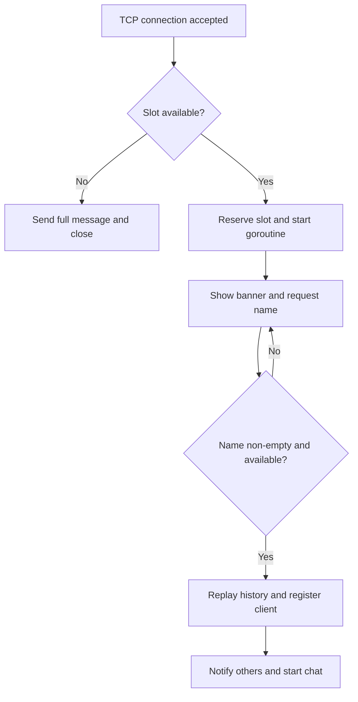

Net-Cat — TCP Group Chat
A terminal group chat server written in Go. Multiple clients connect using nc, choose a name, and exchange timestamped messages over TCP.

This project implements a TCP chat server inspired by NetCat. The client is an external program such as nc; this repository does not implement a separate client executable or the complete NetCat command set.

Built as part of the Reboot 01 program.
Contents
- Features
- Requirements
- Project Structure
- Setup
- Start the Server
- Connect Clients
- Chat Behavior
- Change Your Name
- How It Works
- Tests
- Bonus Features
- Implementation Limits
- Troubleshooting
- Authors
Features
- Accepts up to 10 simultaneous TCP connections, including clients still entering their names.
- Requires a non-empty name and rejects duplicate names without regard to letter case.
- Sends chat messages to all connected, registered clients, including the sender.
- Identifies each message with its send time and the sender's name.
- Ignores empty and whitespace-only chat messages.
- Replays previous chat messages to new clients.
- Notifies other clients when someone joins or leaves.
- Keeps remaining clients connected when another client disconnects.
- Supports changing names with /name NewName.
- Notifies other clients when a name changes.
- Uses goroutines and mutexes to handle concurrent clients.
- Applies a three-second write deadline to registered-client sends and history replay.
Requirements
- Go 1.25.6 or newer, matching the minimum version declared in go.mod.
- A terminal with a TCP client such as nc.
- Git if cloning the repository.
The application uses the Go standard library and has no third-party dependencies.
Technology Stack
Technology	Role
Go standard library	Networking, input handling, and timestamps.
TCP	Persistent connections between clients and the server.
Netcat (nc)	Terminal client used to join the chat.
Goroutines	One handler per accepted connection within the connection limit.
sync.Mutex	Coordinates shared server state and client writes.
Map and slice	Track registered clients and store message history.

Project Structure
Place the files in the following locations:
File	Purpose
go.mod	Declares module net-cat and Go version 1.25.6.
main.go	Reads the port argument and starts the server.
tcpchat/server.go	Manages connections, chat history, broadcasts, and name changes.
tcpchat/client.go	Reads client input and writes messages and prompts.
tcpchat/logo.go	Contains the Linux penguin welcome banner.
tcpchat/server_test.go	Contains the supplied unit tests.
.gitignore	Excludes executables, test output, and editor files.
README.md	Project documentation.

Setup
Clone the project and enter its directory:
git clone https://learn.reboot01.com/git/aaltaire/net-cat
cd net-cat
Check your Go version:
go version
Build the executable:
go build -o TCPChat .
Run commands from the project root, where go.mod is located.
Start the Server
Default port
./TCPChat
Expected output:
Listening on the port :8989
Custom port
./TCPChat 2525
Expected output:
Listening on the port :2525
Too many arguments
./TCPChat 2525 localhost
Expected output:
[USAGE]: ./TCPChat $port
The server accepts zero or one argument. A single invalid or unavailable port is passed to the TCP listener; a listening failure is printed as Server error: ....
Run without building
# Default port
go run .

# Custom port
go run . 2525
Keep the server terminal open while clients are connected.
Windows PowerShell
go build -o TCPChat.exe .
.\TCPChat.exe 2525
Connect Clients
Start the server on port 2525, then open a separate terminal for each client:
nc localhost 2525
For the default server port:
nc localhost 8989
Each connection receives the Linux penguin banner and this prompt:
[ENTER YOUR NAME]:
Enter a name and press Enter. For example:
[ENTER YOUR NAME]: Ali
Leading and trailing spaces are removed from names. A blank or whitespace-only name prompts again. If another connected client is named Ali, names such as ali and ALI are also rejected.

Once registered, type a message and press Enter to send it.
Connect from another computer
Use the server computer's LAN IP address instead of localhost:
# Example: replace 192.168.1.10 with the server computer's actual IP.
nc 192.168.1.10 2525
Both computers must have a network route to each other, and the server's firewall must allow inbound TCP traffic on the chosen port. The server listens on :<port>, rather than only on loopback.
Windows client alternative
If nc is unavailable and your curl build supports Telnet:
curl.exe telnet://localhost:2525
For another computer, replace localhost with the server's IP address. Type your name and messages, pressing Enter after each line.
Chat Behavior
Message format
[YYYY-MM-DD HH:MM:SS][Name]:Message
Example:
[2026-10-22 16:30:00][Ali]:Hello everyone!
Message timestamps use the server's local time when it processes the message. The input prompt also contains a timestamp; that prompt timestamp is created when the prompt is displayed.

The sender receives the formatted message too. A terminal that locally echoes typed input may therefore show both the typed line and the server's timestamped copy.
Join and leave notifications
Other registered clients receive:
Ali has joined our chat...
Ali has left our chat...
A join is announced after the client selects an available, non-empty name.
Message history
Newly registered clients receive all stored chat messages before their first chat prompt. History is shared by the single chat room and kept in memory while the server runs.

Join, leave, and rename notifications are not stored in message history. Restarting the server clears history.
Empty messages
Empty lines and lines containing only whitespace are not broadcast or saved. The client receives a fresh prompt.
Connection limit
When all ten connection slots are occupied, an additional client receives:
Chat is full. Maximum 10 connections allowed.
That extra connection is closed. Clients waiting to enter a name count toward the limit. A slot becomes available after a connection is cleaned up.
Change Your Name
During a chat, enter:
/name Ahmed
The requester receives:
Your name is now Ahmed.
Other clients receive:
Ali changed their name to Ahmed...
Input or condition	Response
/name with no new name	Usage: /name NewName
A name already used by another client	Username already taken. Please choose another name.
Exactly the same current name	You are already using that name.

Name comparisons against other clients ignore case. A client may change the capitalization of their own name. Rename commands are not saved as chat messages.
Disconnect and Stop
- Press Ctrl+C in a client terminal to disconnect that client.
- Press Ctrl+C in the server terminal to stop the server and end its connections.
- Disconnecting one client leaves the server and the other clients running.
How It Works
Every client communicates through its own TCP connection to one server. The server handles registration, history, and message distribution for a single shared room.
Connection Flow

Server Lifecycle
1. main.go selects port 8989 unless one port argument is supplied.
2. RunServer creates a TCP listener and accepts incoming connections.
3. The server reserves a connection slot and starts a goroutine for that client.
4. The client receives the welcome banner and chooses an available name.
5. The server replays history, registers the client, and announces the join.
6. The chat loop reads complete lines, handles name changes, and publishes messages.
7. When the handler ends, the client is removed, other clients are notified if it had joined, and the connection slot is released.
Concurrency and Shared State
A server mutex protects shared state and keeps history replay, registration, and broadcasts ordered. Each client also has a write mutex to prevent simultaneous writes to the same connection from interleaving.
go server.handleConnection(conn)
This starts a goroutine for each connection admitted by the connection limit. Network writes made while holding the server mutex can still delay other operations; goroutines do not eliminate that shared lock.
Structure	Field	Responsibility
Server	mu sync.Mutex	Coordinates access to shared server state.
Server	clients map[*Client]bool	Tracks registered chat members.
Server	history []string	Stores formatted chat messages.
Server	connections int	Counts reserved TCP connections, including unnamed clients.
Client	conn net.Conn	Holds the TCP connection.
Client	name string	Holds the current username.
Client	writeMu sync.Mutex	Serializes writes to the client.

Main Functions
File	Function	Responsibility
main.go	main()	Selects the port and starts the server.
server.go	RunServer()	Listens, accepts connections, and starts handlers.
server.go	newServer()	Initializes the active-client map.
server.go	reserveConnection() / releaseConnection()	Reserve and release connection slots.
server.go	join()	Checks the name, replays history, registers the client, and announces arrival.
server.go	leave()	Removes a member and announces departure.
server.go	publish()	Formats, stores, and broadcasts a message.
server.go	nameTaken() / rename()	Check name availability and process name changes.
server.go	notifyOthers()	Sends notifications to other members.
client.go	handleConnection()	Displays the banner and handles name selection.
client.go	chatLoop()	Reads messages and processes rename commands.
client.go	prompt()	Formats the timestamped username prompt.
client.go	send() / sendWithPrompt()	Write output with a mutex and write deadline.

Tests
Run the supplied unit tests:
go test ./...
Run with detailed output:
go test -v ./...
Run with Go's race detector on a supported platform:
go test -race ./...
Run Go's static checks:
go vet ./...
Format the source files when making changes:
go fmt ./...
The supplied tests cover:
- Initial server state.
- Connection limits and releasing a slot.
- Concurrent connection reservations.
- Case-insensitive duplicate-name checks.
- Renaming without other clients.
- Making a name available after a client leaves.
These are unit tests of server state and helper behavior. They do not establish complete TCP integration coverage or verify every concurrent chat path.
Manual Functional Checklist
Check	Expected behavior
Run ./TCPChat	Listens on port 8989.
Run ./TCPChat 2525	Listens on port 2525.
Run ./TCPChat 2525 localhost	Prints the usage message.
Connect two clients	Both receive the banner and name prompt.
Submit a blank name	Name prompt appears again.
Submit an existing name with different capitalization	Name is rejected.
Register a new client	Other registered clients receive a join notification.
Send a message with three clients connected	All three receive the formatted message.
Send an empty or whitespace-only line	No message is broadcast or added to history.
Connect a new client after messages were sent	Previous chat messages are replayed.
Disconnect one client	Others receive a leave notification and remain connected.
Open an eleventh connection	Extra connection is rejected.
Disconnect a client, then reconnect	The released slot can be used again.
Enter /name NewName	Name changes and others are notified.
Connect from another computer	Connection works when networking and firewall settings permit it.

Packages
Application code imports only these standard-library packages:
bufio
fmt
net
os
strings
sync
time
The test file additionally imports testing, the standard Go test framework.
Bonus Features
Bonus	Implementation
Change client names	Implemented with /name NewName.
Notify the chat about name changes	Implemented.
Multiple separate chat rooms within one server	Not implemented.
Additional NetCat flags	Not implemented.
Client activity logs	No dedicated server-side activity logging.
Save logs to a file	Not implemented.
Terminal UI using gocui	Not implemented.
Unit test file	Included.

Implementation Limits
- Chat history is unbounded in memory and is not saved to disk.
- The default bufio.Scanner token limit applies, so a sufficiently long input line ends that client's handler.
- Scanner read errors end the handler without a dedicated diagnostic message.
- Initial welcome/name-retry writes and the full-server rejection write do not set write deadlines.
- Broadcasts and history replay perform network writes while holding the server mutex, so slow clients can temporarily delay other operations.
- Names identify chat participants; the server does not provide authentication or TLS encryption.
- The server does not implement graceful shutdown or persistent sessions.
Troubleshooting
Problem	What to check
address already in use	Stop the other process using the port or choose a different port.
connection refused	Confirm the server is running and the IP address and port are correct.
Remote connection times out	Check network reachability and inbound TCP firewall rules.
nc: command not found	Use a terminal with NetCat installed, or the curl alternative if supported.
No chat prompt after connecting	Enter a non-empty, unused name and press Enter.
Chat is full	Disconnect an existing client, including any waiting at the name prompt.
History disappears after restart	History is stored only in server memory.
Source changes do not appear	Stop the server, rebuild the executable, and start it again.
A very long input disconnects the client	The scanner's default input-size limit may have been exceeded.

Learning Outcomes
- Build a TCP listener and manage multiple client connections.
- Use goroutines and mutexes for concurrent server operations.
- Organize application state using structs, maps, and slices.
- Read line-based input with bufio.Scanner.
- Validate names, process commands, and format timestamped messages.
- Replay chat history and broadcast live messages.
- Clean up connections and write unit tests for server behavior.
Authors
Author	Reboot 01 Profile
Abdulrahman Altairey	#aaltaire
Waleed Abdulrahim	#wabdulrah